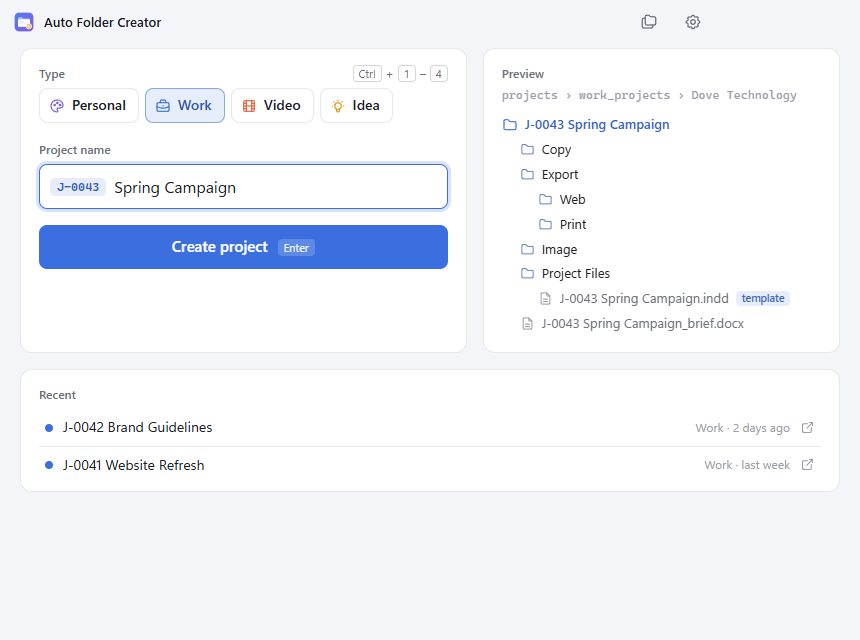
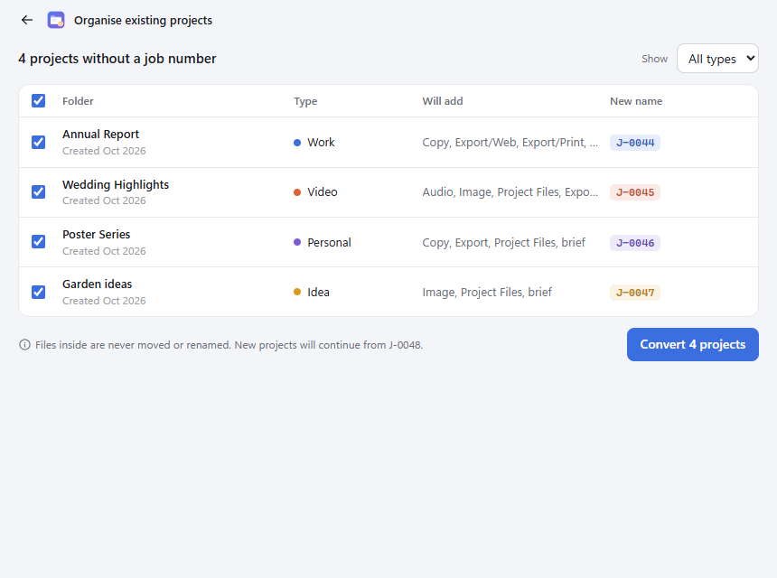
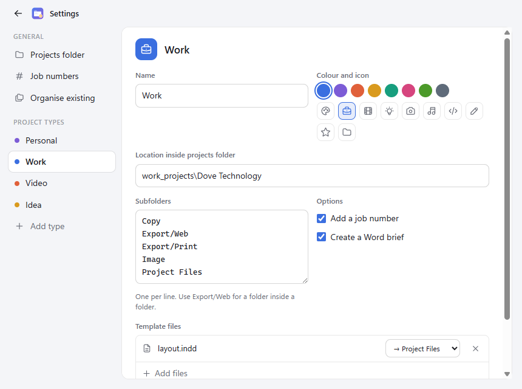

# Auto Folder Creator

A Windows desktop app that sets up a new project folder in one step: the right subfolders, a job number, a Word brief and any template files, based on the type of project.

## Download

**[Download the installer for Windows](https://github.com/tlowndes/Auto-folder-creation/releases/latest/download/Auto-Folder-Creator-Setup.exe)** (about 95MB)

Or get the [portable version](https://github.com/tlowndes/Auto-folder-creation/releases/latest/download/Auto-Folder-Creator-Portable.exe), which runs without installing. All versions are on the [releases page](https://github.com/tlowndes/Auto-folder-creation/releases).

The app isn't code-signed, so Windows may show "Windows protected your PC". Click **More info → Run anyway**.



## Features

- **Project types** (Personal, Work, Video, Idea by default), each with its own location, subfolders, colour and icon
- **Job numbers** like `J-0043 Spring Campaign` from one shared counter
- **Live preview** of the folder tree before anything is created
- **Template files** copied into each new project and renamed to match it
- **Organise existing projects**: add job numbers and missing folders to older projects, with undo
- **Recent projects** list and a warning if the project already exists
- Light and dark mode, Windows 11 Mica window

| Organise existing | Settings |
|---|---|
|  |  |

## Getting started

Requires [Node.js](https://nodejs.org/) 20 or later.

```bash
cd desktop-app
npm install
npm start
```

Build a Windows installer and a portable `.exe` into `desktop-app/dist/`:

```bash
npm run dist
```

See [desktop-app/README.md](desktop-app/README.md) for settings, icons and tests.

## Repository layout

| Folder | Contents |
|---|---|
| `desktop-app/` | The Electron desktop app |
| `legacy/` | The original Python command-line scripts |
